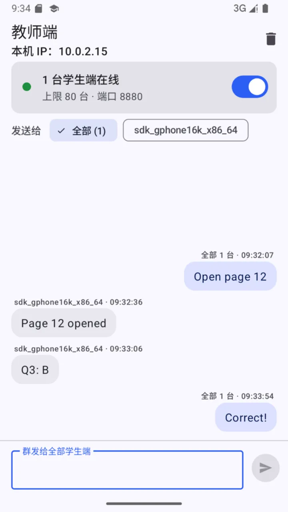
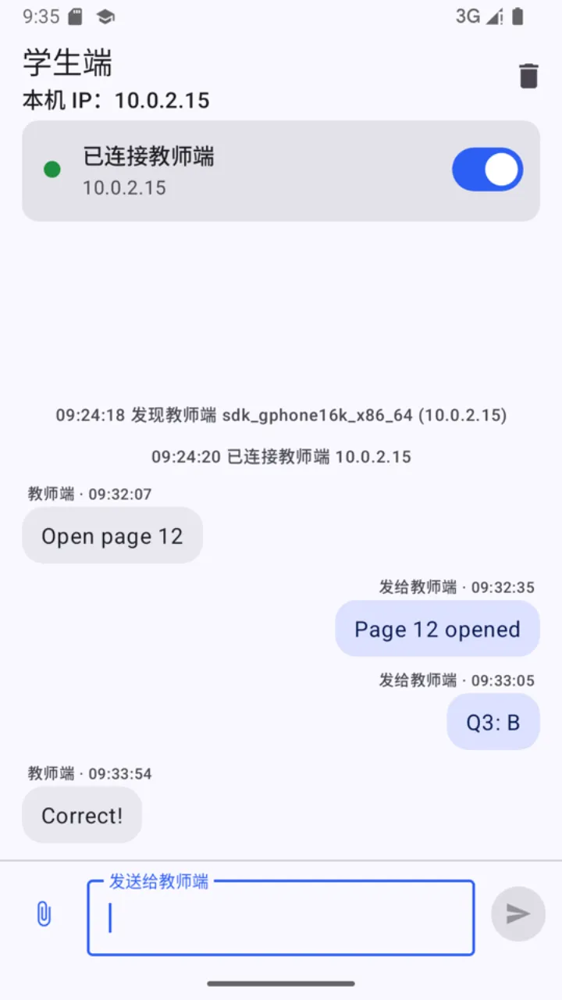

### 他是一个现实到不能再现实却又与现实格格不入的矛盾体。  

<br/>
<br/>

> 2026 年 11 月更新：项目升级到 2.0，组网部分重写成独立的库，本文也按新版本重新整理。

## 需求

我们有两个 App：教师用的移动授课端，学生用来学习和上课的学生端。需求是在局域网内让教师 Pad 控制学生 Pad：教师端发指令，学生端响应。说简单点，就是**局域网下的一对多通信**。

项目地址：[https://github.com/yuqianglianshou/WebSocket](https://github.com/yuqianglianshou/WebSocket)

先看效果。左边是教师端，右边是学生端，两台设备连上后互相发了几条消息：

<div style="display:flex;gap:4%;justify-content:center;">
  
  
</div>

> 本文中「主机 / 教师端 / 服务端」是同一个意思，「从机 / 学生端 / 客户端」是同一个意思。

要解决的核心问题有两个：

1. 局域网里的设备怎么互相发现，拿到对方的 IP？
2. 拿到 IP 之后，怎么建立连接，并且让连接稳定地保持住？

<br/>

## 一、设备发现：UDP 广播

难点在于互相不知道对方的地址。办法是 UDP 广播：UDP 不需要提前建立连接，往局域网的某个端口广播一个包，谁在监听这个端口谁就能收到，而且收到包的同时也就知道了发送方的 IP。

但这只解决了一半：接收方知道了发送方，发送方还不知道接收方。所以要反过来再做一次，**用两个端口互相通知**：

- 主机监听 `8882`，每隔 5 秒往 `8883` 端口广播一次
- 从机监听 `8883`，收到广播后，往主机 IP 的 `8882` 端口单播回一个包

一来一回，双方就都知道了对方的 IP。

包的内容是一段 JSON，可以自己定义字段，不符合规则的包直接丢弃：

```json
{"type":"master","teamId":"Speakin","taskId":"Test","deviceName":"教师 Pad","port":8880}
```

`teamId + taskId` 用来分组。同一个网络里如果有好几个班同时上课，每个学生端只会响应自己班的教师端。`port` 告诉从机 WebSocket 服务在哪个端口。

**广播地址**发往哪里也有讲究。一般用 `255.255.255.255`，但有些路由器不转发这个地址。手机开热点时，热点所在的网段（比如 `192.168.43.x`）也有自己的广播地址。所以 2.0 里主机会同时往 `255.255.255.255` 和**每个网卡的定向广播地址**各发一份，Wi-Fi、热点、有线网络都能覆盖到。

<br/>

## 二、通信方式：为什么选 WebSocket

拿到 IP 之后，最直接的做法是自己写 TCP Socket。它很可靠，但只提供了最基础的字节流：消息怎么分包、心跳怎么做、连接断了怎么感知，全都要自己实现，工作量不小。

WebSocket 正好把这些都包好了：

- 直接支持文本消息和二进制数据（文件）
- 连接建立、断开都有对应的回调
- 自带 ping/pong 心跳机制

而且这个场景天然就是 C/S 模式，只不过服务端不在云上，而是在同一个局域网的教师 Pad 上。

Android 上的 WebSocket 库大多只有客户端，能当服务端的不多。1.0 用的是 AndroidAsync，2.0 换成了：

- **学生端**：OkHttp 4.12，成熟稳定，心跳也是现成的
- **教师端**：Java-WebSocket 1.5.7。OkHttp 只有客户端，所以服务端选了这个纯 Java 实现

<br/>

## 三、连接的建立与维护

能连上只是第一步，课堂上更重要的是连接稳定：几十台设备同时在线，Wi-Fi 时好时坏，教师还会切到别的 App 去放课件。2.0 主要在这几个方面下了功夫。

**握手时就把关。** 学生端发起 WebSocket 连接时，在请求头里带上自己的设备 ID、设备名和分组：

| 请求头 | 作用 |
| --- | --- |
| `X-Lan-Device-Id` | 设备唯一 ID，首次启动时随机生成并保存 |
| `X-Lan-Device-Name` | 设备名，URL 编码，支持中文 |
| `X-Lan-Team` / `X-Lan-Task` | 分组 |

教师端在握手阶段就检查分组和人数上限（默认 80 台），不符合直接拒绝。这样学生端拿到的是一个明确的失败，而不是"连上了又被踢掉"。

**按设备识别，而不是按 IP。** 1.0 用 IP 区分学生端，同一 IP 后面有多台设备时就会出问题。现在按设备 ID 识别。学生端断线重连时，旧连接可能还没被清理，这时新连接会直接顶替旧连接。

**心跳检测断线。** 学生端每 10 秒发一次 ping，按时收不到 pong 就认为连接断了。Wi-Fi 静默断开（比如走出信号范围）这种没有任何通知的情况，也能较快发现。教师端会清理 30 秒内没有响应的连接。

**断线后退避重连。** 1.0 断线后固定每 2 秒重连一次，满员时几十台设备会反复冲击教师端。2.0 改成指数退避：从 2 秒开始，逐次翻倍，最长 30 秒，再加上 ±20% 的随机抖动，让大家错开时间。前两次直接连上次的教师端（多半只是网络抖了一下），还连不上再回到 UDP 广播重新搜索。被明确拒绝（满员、分组不符）时直接进入长间隔。

**教师端放进前台服务。** 测试时发现，教师端切到后台一段时间后会被系统回收，全班一起断线。现在教师端的组网逻辑运行在前台服务里，切到别的 App、锁屏、退出页面都不会断，通知栏显示当前在线人数，也可以从通知栏直接停止。

<br/>

## 四、升级 2.0 时踩过的坑

**1. 换成 OkHttp 后，真机上连不上了。**
JVM 上的测试全部通过，一上手机就报 `CLEARTEXT communication not permitted`。原因是 Android 9 起默认禁止明文网络请求，OkHttp 会遵守这个系统策略，而局域网用的正是明文的 `ws://`。局域网 IP 不固定，没法按域名或网段单独放行，最后在 Manifest 里声明了 `android:usesCleartextTraffic="true"`。

**2. 群发时偶尔崩溃。**
群发是遍历所有连接，逐个先判断是否在线、再发送。但这两步之间连接随时可能断开，这时发送会直接抛异常。解决办法是发送时捕获异常，失败的那台跳过即可。

**3. 开着移动数据时，显示的本机 IP 不对。**
原来的逻辑只判断是否为内网地址，有些运营商分配给移动数据的也是内网地址。现在优先取 Wi-Fi、热点、有线网卡的地址。

**4. 前台服务类型怎么选。**
一开始想用 `dataSync`，但 Android 15 限制这种类型最多运行 6 小时，一整天的课撑不住。最后选了 `connectedDevice`，含义是"与外部设备保持连接"，也正好符合这个场景。

**5. 一个转圈动画耗掉三分之一 CPU。**
教师端"等待学生加入"时，状态卡片上有个转圈的进度条。这个状态可能持续一整节课，渲染线程一直占着 30% 多的 CPU。现在只有"正在连接"这类几秒内就结束的状态才显示动画。

<br/>

## 五、项目结构

```
WebSocket/
├── lan-core/     组网库（无 UI）：UDP 发现、WebSocket 主从、重连状态机
├── app-common/   两个 App 共用的界面组件
├── server/       教师端 App
└── client/       学生端 App
```

组网部分是独立的 `lan-core` 模块，不依赖任何界面，可以直接拿到自己的项目里用：

```java
// 教师端
MasterControlManager master = new MasterControlManager(context, LanConfig.defaults());
master.setCallback(callback);
master.start();
master.broadcast("上课了");                // 群发
master.sendTo(client.id, "请回答第 3 题");   // 单发

// 学生端
SlaveControlManager slave = new SlaveControlManager(context, LanConfig.defaults());
slave.setCallback(callback);
slave.start();                            // 自动发现、连接、断线重连
slave.send("收到");
```

完整的接入方式、配置项和协议细节见项目的 [README](https://github.com/yuqianglianshou/WebSocket#readme)。

<br/>

## 几点说明

1. 开启顺序不分先后。两端都打开后，通常 5 秒内就能连上。
2. 教师端和学生端可以装在同一台设备上调试。
3. 部分公司或公共场所的 Wi-Fi 开启了 AP 隔离，或者屏蔽了广播，设备之间互相发现不了。这种情况换成手机热点或普通家用路由器即可。
4. 目前文件是整个文件一次性发送，上限 15MB。更大的文件需要分片传输，后续再做。

<br/>

## 致谢

1.0 版本基于 [szuwest/Recorder](https://github.com/szuwest/Recorder) 修改，「UDP 广播发现 + WebSocket 通信」的思路来自这位作者，请给他掌声。2.0 在这个思路的基础上重写了全部代码。

<br/>
<br/>
<br/>
