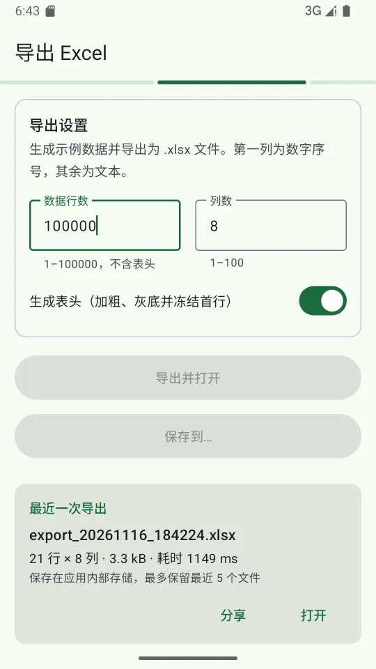
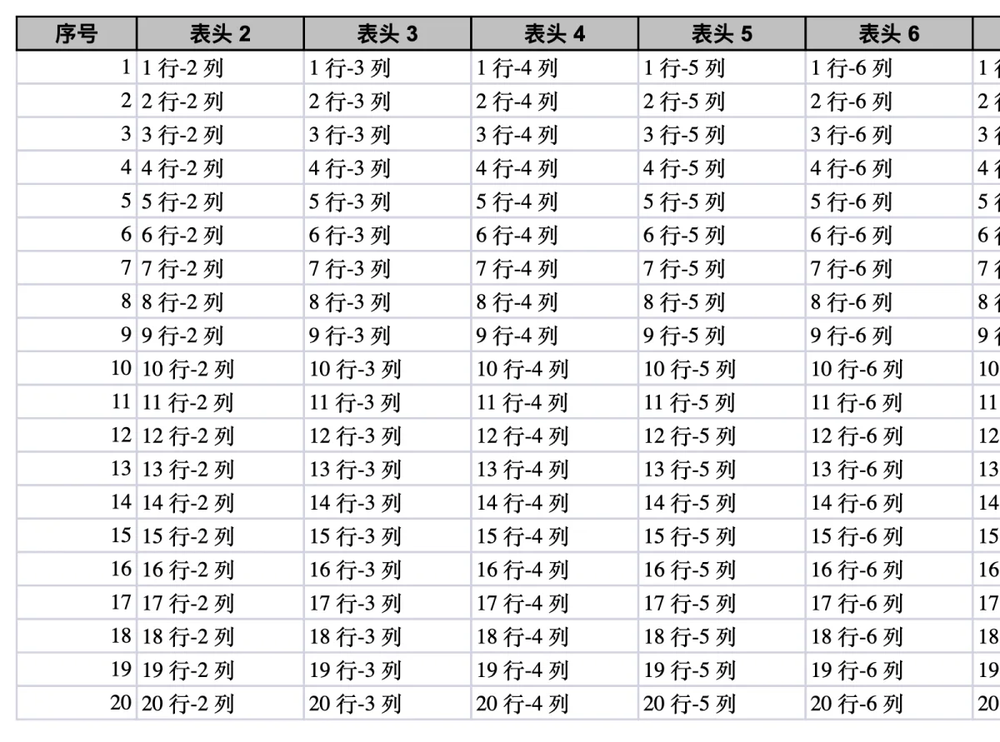

### 我学会了很多东西，勤俭 隐忍 坚持 淡然 息事宁人，却没学会享受生活。
<br/>
<br/>

> 2026 年 11 月更新：项目升级到 1.1。去掉了 jxl，改成自己写 `.xlsx` 文件，也不再需要存储权限。本文按新版本重新整理。

## 需求

App 里有一份列表数据，需要导出成 Excel 表格，让用户发给同事或在电脑上继续处理。

项目地址：[https://github.com/yuqianglianshou/ExportExcelFile](https://github.com/yuqianglianshou/ExportExcelFile)

先看效果。左边是主界面，右边是正在导出 10 万行的状态，下方卡片是上一次导出的结果：

<div style="display:flex;gap:4%;justify-content:center;">
  
  
</div>

导出的文件长这样。第一列是数字，所以靠右对齐；表头加粗、灰底，并冻结在首行：

{:width="80%"}

## 为什么不再用 jxl

旧版本用的是 jxl。2021 年时它还能用，现在回头看问题不少：

- jxl 最后一次发布是 2009 年，早已停止维护。
- 它只能写 `.xls`（Excel 97-2003 格式），单表最多 65536 行、256 列。新版 Excel 打开时会提示兼容模式。
- 写出来的单元格全是文本。数字列在 Excel 里会被标成「以文本形式存储的数字」，不能直接求和。
- 混淆时要额外加 `-keep class jxl.** {*;}`，不然运行时会崩。

另一个常见选择是 Apache POI。它功能很全，但体积有好几 MB，还用到了 `java.awt`、StAX（`javax.xml.stream`）等 Android 上没有的类，在手机上用起来很别扭。

其实「把一张表导出给人看」这个需求很简单。`.xlsx` 本质上就是一个 zip 包，里面放几个 XML 文件。用 JDK 自带的 `ZipOutputStream` 自己写，三百来行代码就够了，零依赖。

## xlsx 文件里有什么

把任意一个 `.xlsx` 改名成 `.zip` 解压，就能看到它的结构。一个能被 Excel 正常打开的最小文件只需要 6 个部分：

```
[Content_Types].xml          声明包里每个文件的类型
_rels/.rels                  入口：指向 xl/workbook.xml
xl/workbook.xml              工作簿：有哪些表单（sheet）
xl/_rels/workbook.xml.rels   工作簿到表单、样式表的引用关系
xl/styles.xml                样式表：字体、填充、边框
xl/worksheets/sheet1.xml     表单的实际数据
```

除了 `sheet1.xml`，其余 5 个文件的内容都是固定的，写成常量即可。真正需要生成的只有 `sheet1.xml`，它大概是这样：

```xml
<worksheet xmlns="http://schemas.openxmlformats.org/spreadsheetml/2006/main">
  <!-- 冻结首行 -->
  <sheetViews><sheetView workbookViewId="0">
    <pane ySplit="1" topLeftCell="A2" activePane="bottomLeft" state="frozen"/>
  </sheetView></sheetViews>
  <!-- 列宽 -->
  <cols><col min="1" max="1" width="10" customWidth="1"/></cols>
  <sheetData>
    <row r="1">
      <!-- s="1" 引用 styles.xml 里的表头样式；t="inlineStr" 表示文本 -->
      <c r="A1" s="1" t="inlineStr"><is><t>序号</t></is></c>
    </row>
    <row r="2">
      <c r="A2"><v>1</v></c>                       <!-- 数值：不写 t -->
      <c r="B2" t="b"><v>1</v></c>                 <!-- 布尔 -->
      <c r="C2" t="inlineStr"><is><t>文本</t></is></c>
    </row>
  </sheetData>
</worksheet>
```

文本用的是 `inlineStr`（内联字符串），直接写在单元格里，不用另外维护一张共享字符串表（`sharedStrings.xml`）。这样代码简单很多，也能边遍历边写出，不用先把所有字符串收集起来。

## 核心代码：XlsxWriter

完整代码见 [XlsxWriter.kt](https://github.com/yuqianglianshou/ExportExcelFile/blob/main/app/src/main/java/com/moon/exportexcelfile/excel/XlsxWriter.kt)。它不依赖任何 Android API，复制到自己项目里就能用，也可以直接在 JVM 上写单元测试。

用法：

```kotlin
val rows: List<List<Any?>> = listOf(
    listOf("姓名", "年龄", "在职"),   // 第一行作为表头
    listOf("张三", 28, true),
    listOf("李四", 31.5, false),
)
XlsxWriter.writeToFile(File(context.filesDir, "exports/员工.xlsx"), rows, sheetName = "员工")
```

### 写出 zip 包

所有部分共用一个 `ZipOutputStream`，每个部分是 zip 里的一个 entry：

```kotlin
fun write(out: OutputStream, rows: List<List<Any?>>, sheetName: String = "Sheet1", hasHeader: Boolean = true) {
    validate(rows)
    val columnWidths = measureColumns(rows)   // 第一遍：算列宽

    val zip = ZipOutputStream(out.buffered())
    val writer = BufferedWriter(OutputStreamWriter(zip, Charsets.UTF_8))
    fun entry(name: String, block: BufferedWriter.() -> Unit) {
        zip.putNextEntry(ZipEntry(name))
        writer.block()
        writer.flush()          // 切换 entry 前必须 flush，否则内容会写进下一个 entry
        zip.closeEntry()
    }

    entry("[Content_Types].xml") { write(CONTENT_TYPES) }
    entry("_rels/.rels") { write(ROOT_RELS) }
    entry("xl/workbook.xml") { write(workbookXml(safeSheetName(sheetName))) }
    entry("xl/_rels/workbook.xml.rels") { write(WORKBOOK_RELS) }
    entry("xl/styles.xml") { write(STYLES) }
    entry("xl/worksheets/sheet1.xml") { writeSheet(this, rows, columnWidths, hasHeader) }  // 第二遍：写数据
    zip.finish()
    zip.flush()
}
```

注意最后用的是 `finish()` 而不是 `close()`。这个方法不负责关闭传进来的 `out`，由调用方决定什么时候关。后面通过 SAF 拿到的输出流会用到这一点。

列宽要在写 `<sheetData>` 之前确定（`<cols>` 必须出现在它前面），所以数据要遍历两遍：第一遍只算每列最长内容的宽度，第二遍才真正写入。中文在 Excel 里大约占两个字符宽，计算时按 2 算：

```kotlin
internal fun displayWidth(text: String): Int =
    text.fold(0) { acc, ch -> acc + if (ch.code > 0xFF) 2 else 1 }
```

### 写单元格

按值的类型决定单元格类型。数值和布尔值按真实类型写入，其余一律当文本：

```kotlin
private fun writeCell(out: Appendable, ref: String, value: Any, style: Int) {
    out.append("<c r=\"").append(ref).append('"')
    if (style != STYLE_DEFAULT) out.append(" s=\"").append(style.toString()).append('"')

    val number = numberText(value)
    when {
        number != null -> out.append("><v>").append(number).append("</v></c>")
        value is Boolean -> out.append(" t=\"b\"><v>").append(if (value) "1" else "0").append("</v></c>")
        else -> {
            val text = value.toString()
            out.append(" t=\"inlineStr\"><is><t")
            // 首尾空白默认会被 Excel 去掉，需显式保留
            if (text.isNotEmpty() && (text.first().isWhitespace() || text.last().isWhitespace())) {
                out.append(" xml:space=\"preserve\"")
            }
            out.append('>')
            appendEscaped(out, text)
            out.append("</t></is></c>")
        }
    }
}

/** NaN、无穷大不是合法数值，返回 null 让它按文本写入 */
private fun numberText(value: Any): String? = when (value) {
    is Int, is Long, is Short, is Byte, is BigInteger -> value.toString()
    is BigDecimal -> value.toPlainString()   // 避免写出 1E+20 这样的科学计数法
    is Double -> value.takeIf { it.isFinite() }?.toString()
    is Float -> value.takeIf { it.isFinite() }?.toString()
    is Number -> value.toDouble().takeIf { it.isFinite() }?.toString()
    else -> null
}
```

单元格引用（`A1`、`AA10`）里的列名是 26 进制，但没有 0，需要单独转换：

```kotlin
/** 0 -> A，25 -> Z，26 -> AA */
internal fun columnName(index: Int): String {
    val sb = StringBuilder()
    var n = index + 1
    while (n > 0) {
        val rem = (n - 1) % 26
        sb.append('A' + rem)
        n = (n - 1) / 26
    }
    return sb.reverse().toString()
}
```

### 几个容易踩的坑

**XML 转义和非法字符。** 除了 `& < > "` 要转义，XML 1.0 还不允许出现大部分控制字符（`\u0000` 到 `\u001F`，换行和制表符除外）。用户数据里混进一个这样的字符，Excel 打开时就会报「文件已损坏」。所以转义时直接丢掉它们：

```kotlin
private fun appendEscaped(out: Appendable, text: String) {
    for (ch in text) {
        when (ch) {
            '&' -> out.append("&amp;")
            '<' -> out.append("&lt;")
            '>' -> out.append("&gt;")
            '"' -> out.append("&quot;")
            '\t', '\n', '\r' -> out.append(ch)
            else -> if (ch >= ' ' && ch != '￾' && ch != '￿') out.append(ch)
        }
    }
}
```

**表单名有限制。** 最长 31 个字符，不能包含 `\ / ? * [ ] :`，否则 Excel 同样打不开：

```kotlin
internal fun safeSheetName(name: String): String {
    val cleaned = name.replace(Regex("[\\\\/?*\\[\\]:]"), "_").trim('\'').take(31)
    return cleaned.ifBlank { "Sheet1" }
}
```

**写到一半失败。** 旧版本是先删掉旧文件再写新文件，中途出错就会留下一个打不开的半截文件。现在先写到同目录的临时文件，成功后再替换：

```kotlin
fun writeToFile(file: File, rows: List<List<Any?>>, sheetName: String = "Sheet1", hasHeader: Boolean = true) {
    validate(rows)
    val dir = file.absoluteFile.parentFile ?: throw IOException("无法确定父目录: ${file.absolutePath}")
    if (!dir.exists() && !dir.mkdirs()) throw IOException("目录创建失败: ${dir.absolutePath}")

    val tmp = File(dir, "${file.name}.tmp")
    try {
        tmp.outputStream().use { write(it, rows, sheetName, hasHeader) }
        if (file.exists() && !file.delete()) throw IOException("旧文件删除失败: ${file.absolutePath}")
        if (!tmp.renameTo(file)) throw IOException("重命名失败: ${tmp.absolutePath} -> ${file.absolutePath}")
    } finally {
        if (tmp.exists()) tmp.delete()
    }
}
```

### 导出大量数据

`XlsxWriter` 接收的是 `List<List<Any?>>`，但它只会按下标顺序读取，不要求数据真的都放在内存里。示例项目的演示数据用 `AbstractList` 按需生成每一行：

```kotlin
fun rows(config: ExportConfig): List<List<Any?>> = object : AbstractList<List<Any?>>() {
    private val headerOffset = if (config.hasHeader) 1 else 0
    override val size: Int = config.totalRows
    override fun get(index: Int): List<Any?> =
        if (index < headerOffset) header(config.columnCount) else row(index - headerOffset + 1, config.columnCount)
}
```

实际项目里也可以用同样的思路包装数据库游标或分页查询。写入是边生成边输出的，所以导出 10 万行时内存占用依然很小。在电脑的 JVM 上，10 万行 × 8 列大约需要 1.5 秒，生成的文件约 3.3 MB。

## 文件存在哪里

旧版本把文件写到 `getExternalFilesDir()`，也就是 `/sdcard/Android/data/包名/files/Documents/`，还申请了 `WRITE_EXTERNAL_STORAGE` 权限。现在这两样都不合适了：

- 从 Android 10 开始实行分区存储（Scoped Storage），`WRITE_EXTERNAL_STORAGE` 基本失效。
- 从 Android 11 开始，大多数文件管理器已经进不去 `Android/data` 目录，用户根本找不到导出的文件。

新版本给了两种方式，**都不需要任何存储权限**。

### 方式一：导出并打开

文件写到应用内部存储 `filesDir/exports/`，再通过 `FileProvider` 生成 `content://` 链接交给其他应用打开或分享。为了不让内部存储无限增长，只保留最近 5 个文件。

`FileProvider` 只暴露这一个目录，不要像旧版本那样用 `external-path path="."` 把整个外部存储都暴露出去。`res/xml/provider_paths.xml` 的内容如下：

```xml
<paths>
    <files-path name="exports" path="exports/" />
</paths>
```

`AndroidManifest.xml` 中注册 `FileProvider` 的写法和以前一样：

```xml
<provider
    android:name="androidx.core.content.FileProvider"
    android:authorities="${applicationId}.fileprovider"
    android:exported="false"
    android:grantUriPermissions="true">
    <meta-data
        android:name="android.support.FILE_PROVIDER_PATHS"
        android:resource="@xml/provider_paths" />
</provider>
```

### 方式二：保存到…

调用系统的「另存为」界面（SAF，存储访问框架），让用户自己选位置，可以是下载目录、网盘等等。用 Activity Result API 一行就能注册：

```kotlin
private val createDocument =
    registerForActivityResult(ActivityResultContracts.CreateDocument(XlsxWriter.MIME_TYPE)) { uri ->
        viewModel.onSaveLocationChosen(uri?.toString())
    }

// 点击按钮时，传入建议的文件名
createDocument.launch("export_20261118_093000.xlsx")
```

拿到 `uri` 后用 `ContentResolver` 打开输出流写入。这里就用上了前面说的「`write()` 不关闭流」，由 `use` 负责关闭：

```kotlin
contentResolver.openOutputStream(uri, "wt")?.use { out ->
    XlsxWriter.write(out, rows, SHEET_NAME, hasHeader)
}
```

`"wt"` 表示写入前清空原有内容。用户选择覆盖已有文件时，如果只用 `"w"`，在部分系统上旧内容不会被截断，文件尾部会残留旧数据。

## 打开和分享文件

旧版本的 `FileUtils` 写了一百多行，根据扩展名判断十几种 MIME 类型，还要区分 Android 7.0 前后用 `Uri.fromFile` 还是 `FileProvider`。现在 `minSdk` 是 21，文件也都通过 `content://` 提供，只需要两个方法：

```kotlin
object FileActions {

    fun open(context: Context, uri: Uri, mimeType: String): Boolean {
        val intent = Intent(Intent.ACTION_VIEW)
            .setDataAndType(uri, mimeType)
            .addFlags(Intent.FLAG_GRANT_READ_URI_PERMISSION)
        return start(context, intent)
    }

    fun share(context: Context, uri: Uri, mimeType: String, title: CharSequence): Boolean {
        val intent = Intent(Intent.ACTION_SEND)
            .setType(mimeType)
            .putExtra(Intent.EXTRA_STREAM, uri)
            .addFlags(Intent.FLAG_GRANT_READ_URI_PERMISSION)
        // 部分系统只会把 ClipData 中的 Uri 授权给目标应用
        intent.clipData = ClipData.newRawUri(null, uri)
        return start(context, Intent.createChooser(intent, title))
    }

    private fun start(context: Context, intent: Intent): Boolean = try {
        context.startActivity(intent)
        true
    } catch (e: ActivityNotFoundException) {
        false
    }
}
```

MIME 类型要和格式对应。旧版本给 `.xlsx` 也用了 `application/vnd.ms-excel`，那其实是 `.xls` 的类型。`.xlsx` 的正确类型是：

```
application/vnd.openxmlformats-officedocument.spreadsheetml.sheet
```

类型写错时，有些应用会不出现在「打开方式」列表里。

## 界面与架构

旧版本把生成数据、写文件、打开文件都写在 `MainActivity` 里，并且在主线程写文件。数据一多就会卡住界面，旋转屏幕还会把正在进行的导出打断。新版本按 MVVM 拆成几层：

```
excel/XlsxWriter.kt        xlsx 写入器，纯 Kotlin
data/DemoData.kt           按需生成的演示数据
data/ExportRepository.kt   文件读写（在 Dispatchers.IO 上执行）、FileProvider、SAF
ui/MainViewModel.kt        输入校验、界面状态（StateFlow）、一次性事件（Channel）
ui/MainActivity.kt         只负责渲染状态和转发点击
ui/FileActions.kt          打开 / 分享文件
```

几个值得一提的细节：

- **导出任务放在 ViewModel 里**，旋转屏幕不会中断。「打开文件」「弹出提示」这类事件通过 `Channel` 发送，只会被消费一次，旋转后不会重复弹出。
- **「保存到…」分两步**：先弹出选择器，用户选好位置后再导出。打开选择器期间应用进入后台，可能被系统回收，所以导出参数存在 `SavedStateHandle` 里，回来后能恢复。
- **导出期间按钮不可点**，ViewModel 里也会忽略重复请求，避免连点生成多个文件。
- **界面用 Material 3**，以 Excel 绿为主色，适配深色模式和 Android 15 起强制的全面屏（edge-to-edge）。

## 混淆

以前需要加 jxl 的 keep 规则，现在没有第三方库，也不用反射，开启 R8 后什么都不用加。release 包开启了代码和资源压缩，最终约 1.9 MB，大部分体积来自 Material 组件。

## 测试

`XlsxWriter` 不依赖 Android，可以在电脑上直接跑单元测试。测试的做法是：写出文件，用 `ZipFile` 解压，再用 `DocumentBuilder` 逐个解析 XML，检查单元格类型、转义结果、样式、冻结窗格和列宽是否正确。只要每个 XML 都能被解析、结构正确，Excel 就不会报文件损坏。

```bash
./gradlew testDebugUnitTest
```

## 局限

`XlsxWriter` 只做「导出一张表给人看」，下面这些都不支持：

- 多个工作表
- 公式、合并单元格、图片
- 日期格式（建议先格式化成字符串）
- 读取 Excel

有这些需求时，可以考虑 [FastExcel](https://github.com/dhatim/fastexcel)（同样是流式写入，体积小）或 [Apache POI](https://poi.apache.org/)（功能最全）。

<br/>
<br/>
<br/>
