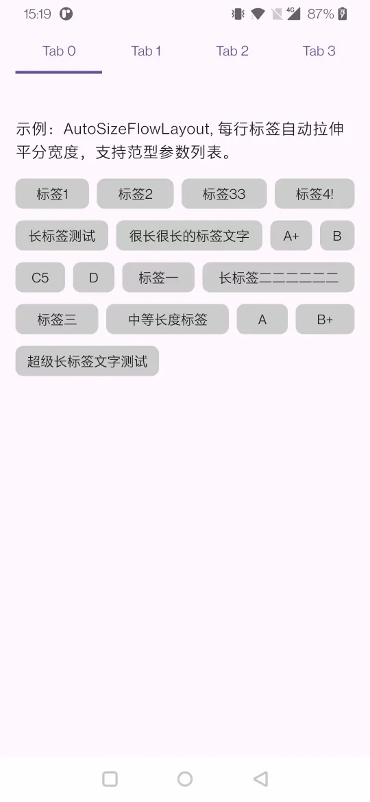
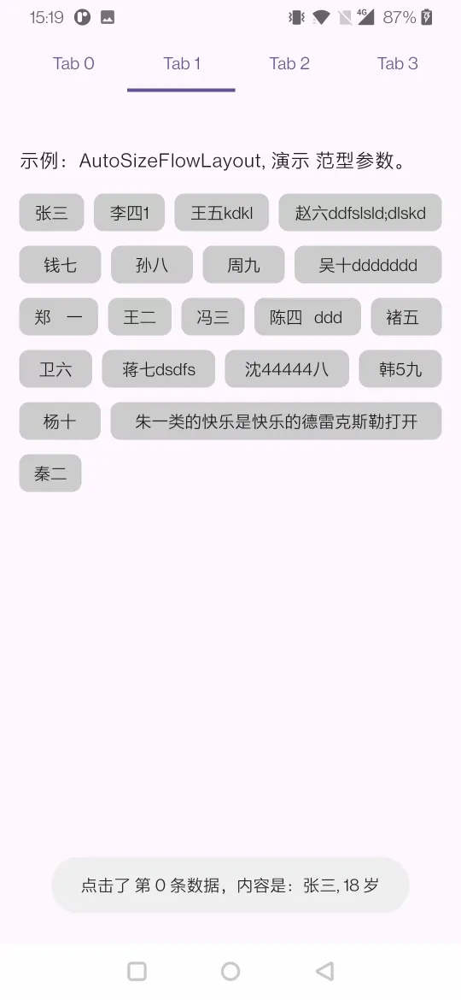
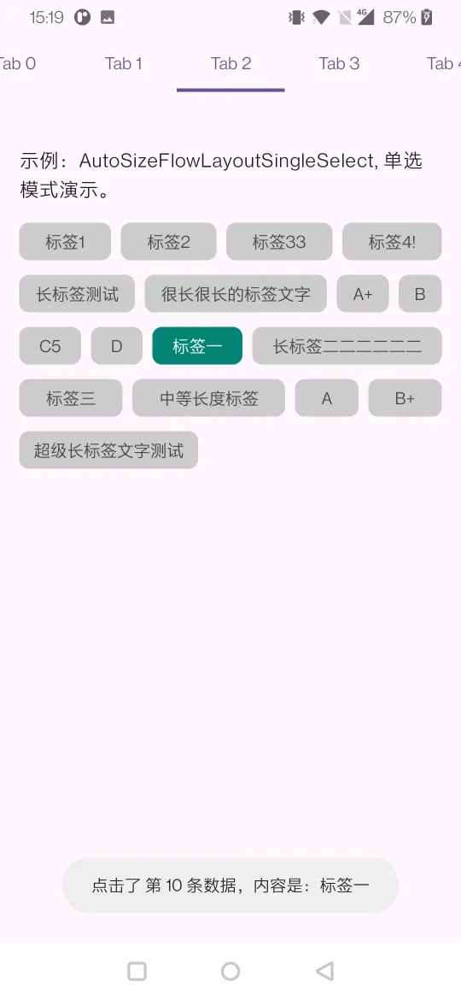
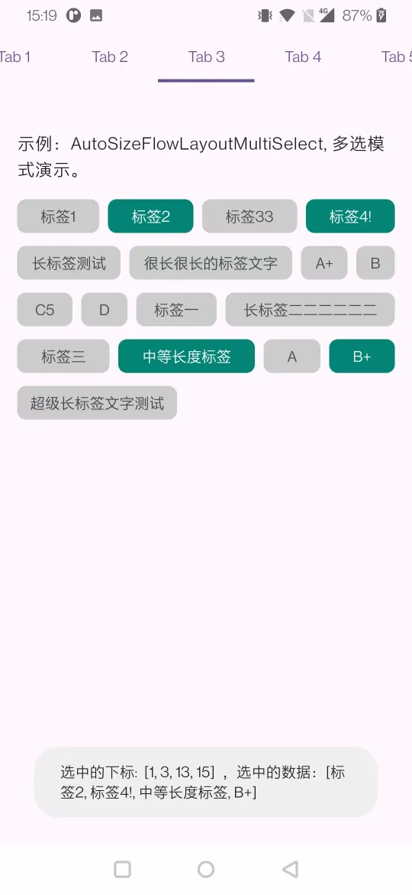

### 一个个大佬走下神坛。

项目地址：[https://github.com/yuqianglianshou/autosize-flowlayout](https://github.com/yuqianglianshou/autosize-flowlayout)

普通流式布局每行末尾会留下一段参差不齐的空白。autosize-flowlayout 把每行的剩余宽度平均分给这一行的各个标签，让每一行都左右撑满，标签排列更整齐。

它是一个 Jetpack Compose 的参考实现，不是发布到 Maven 的库：核心布局只有一个文件、不到 200 行，没有额外依赖，需要时直接复制到自己的项目里即可。

## 效果预览

<div style="display: flex; gap: 10px;">
  
  
  
  
</div>

## 特性

- 每行剩余宽度均分给行内标签：每个标签的宽度 = 内容宽度 + 等额增量。
- 最后一行不拉伸，保持内容宽度，避免只剩一两个标签时被拉得过宽。
- 超长标签独占一行，并以省略号截断。
- 子项可以是任意 Composable，也可以直接传数据列表，用 `label` 函数转成显示文本。
- 提供基础、单选、多选三个组件，选中状态由调用方持有。
- 默认颜色取自 `MaterialTheme.colorScheme`，跟随主题和深色模式。
- 单选 / 多选带无障碍语义（单选按钮 / 复选框角色和选中状态），读屏能正确朗读。
- 只依赖 Compose 基础库，用的都是稳定 API。

## 组件一览

| 组件 | 用途 |
|---|---|
| `AutoSizeFlowLayout` | 通用布局（自定义子项），以及数据列表版本（默认标签样式、点击回调） |
| `AutoSizeFlowLayoutSingleSelect` | 单选 |
| `AutoSizeFlowLayoutMultiSelect` | 多选 |

`AutoSizeFlowLayout.kt` 可以单独复制使用；单选、多选是它上面的薄封装，需要连同它一起复制。

## 使用方式

### 基础用法

```kotlin
AutoSizeFlowLayout(
    modifier = Modifier.fillMaxWidth(),
    dataList = tagList,
    horizontalGap = 8.dp,
    verticalGap = 12.dp,
    onItemClick = { index, item -> /* ... */ }
)
```

自定义数据类型时，用 `label` 指定显示文本：

```kotlin
AutoSizeFlowLayout(
    modifier = Modifier.fillMaxWidth(),
    dataList = userList,
    label = { it.name }
)
```

### 自定义子项

不想用默认标签样式时，用通用版本，每个直接子元素算一个 item：

```kotlin
AutoSizeFlowLayout(
    modifier = Modifier.fillMaxWidth(),
    horizontalGap = 8.dp,
    verticalGap = 12.dp
) {
    tagList.forEach { tag ->
        AssistChip(onClick = { /* ... */ }, label = { Text(tag) })
    }
}
```

### 单选 / 多选

两个组件自身都不保存选中状态，状态由调用方持有、在回调里更新：

```kotlin
var selectedIndex by remember { mutableIntStateOf(0) }   // -1 表示不选

AutoSizeFlowLayoutSingleSelect(
    modifier = Modifier.fillMaxWidth(),
    dataList = tagList,
    selectedIndex = selectedIndex,
    onSelected = { index, item -> selectedIndex = index }
)

var selectedIndexes by remember { mutableStateOf(setOf(0, 2)) }

AutoSizeFlowLayoutMultiSelect(
    modifier = Modifier.fillMaxWidth(),
    dataList = tagList,
    selectedIndexes = selectedIndexes,
    onSelectionChanged = { indexes, items -> selectedIndexes = indexes }
)
```

公共参数有 `horizontalGap`、`verticalGap`（默认都是 `8.dp`）、`label`（默认 `toString()`）和 `textStyle`（默认 `14.sp`）。颜色参数（`bgColor`、`selectedBgColor`、`unselectedTextColor` 等）的默认值都取自 `MaterialTheme.colorScheme`。

## 实现原理

核心是一个自定义 `MeasurePolicy`，分四步：估算宽度 → 分行 → 分配剩余宽度并正式测量 → 摆放。

### 1. 估算宽度

用 `maxIntrinsicWidth` 取每个标签的内容宽度，上限为父容器宽度。上限很关键：超长标签被压到一行宽，后面用固定宽度测量时，`Text` 才会触发省略号。

```kotlin
require(constraints.hasBoundedWidth) { "父容器必须有最大宽度，例如 fillMaxWidth()" }
val maxWidth = constraints.maxWidth

val widths = IntArray(measurables.size) { i ->
    minOf(measurables[i].maxIntrinsicWidth(Constraints.Infinity), maxWidth)
}
```

### 2. 分行

依次累加「标签宽度 + 间距」，超过父容器宽度就换行，每行记为一个下标区间：

```kotlin
val rows = mutableListOf<IntRange>()
var rowStart = 0
var rowWidth = 0
for (i in widths.indices) {
    val needed = if (i == rowStart) widths[i] else rowWidth + hGapPx + widths[i]
    if (needed > maxWidth && i > rowStart) {
        rows.add(rowStart until i)
        rowStart = i
        rowWidth = widths[i]
    } else {
        rowWidth = needed
    }
}
if (widths.isNotEmpty()) rows.add(rowStart until widths.size)
```

`i > rowStart` 保证每行至少放一个标签，超长标签因此独占一行。

### 3. 分配剩余宽度

除最后一行外，每行的剩余宽度按标签数均分，再用 `Constraints.fixedWidth` 正式测量：

```kotlin
val rowPlaceables = rows.mapIndexed { rowIndex, row ->
    val count = row.count()
    val totalGap = hGapPx * (count - 1)
    val contentWidth = row.sumOf { widths[it] }
    val extraWidth = if (rowIndex == rows.lastIndex) 0 else maxWidth - totalGap - contentWidth
    val extraPerItem = extraWidth / count
    val remainder = extraWidth % count

    row.mapIndexed { idx, i ->
        val targetWidth = widths[i] + extraPerItem + if (idx < remainder) 1 else 0
        measurables[i].measure(Constraints.fixedWidth(targetWidth))
    }
}
```

像素不能取小数，余数分给前几个标签，每个多 1px。例如剩余 27px、共 10 个标签，分配结果是 `3 3 3 3 3 3 3 2 2 2`，整行恰好撑满，不会差一两个像素。

### 4. 摆放

逐行从左到右摆放，行高取该行最高的标签：

```kotlin
val rowHeights = rowPlaceables.map { row -> row.maxOf { it.height } }
val layoutHeight = rowHeights.sum() + vGapPx * (rowHeights.size - 1).coerceAtLeast(0)

layout(width = maxWidth, height = constraints.constrainHeight(layoutHeight)) {
    var y = 0
    rowPlaceables.forEachIndexed { rowIndex, row ->
        var x = 0
        row.forEach { p ->
            p.placeRelative(x, y)
            x += p.width + hGapPx
        }
        y += rowHeights[rowIndex] + vGapPx
    }
}
```

`placeRelative` 会在 RTL 语言下自动镜像。另外 `MeasurePolicy` 用 `remember(horizontalGap, verticalGap)` 缓存，间距不变时重组不会生成新的测量策略。

### 单选 / 多选的无障碍

默认标签样式由一个内部的 `AutoSizeFlowTag` 提供，点击相关的 Modifier 从外部传入，放在背景之后、内边距之前，让水波纹和点击区域覆盖整个标签：

- 单选：父布局加 `selectableGroup()`，每个标签用 `Modifier.selectable(role = Role.RadioButton)`。
- 多选：每个标签用 `Modifier.toggleable(role = Role.Checkbox)`，并在回调里丢弃超出当前列表范围的下标，避免数据变短后越界。

这样读屏能读出「单选按钮，已选中」之类的信息，而不只是一段可点击的文字。

## 与官方 FlexBox 的对比

Compose 在 `foundation-layout` 中新增了实验性的 `FlexBox`，给子项设置 `grow` 后，同样会把每行的剩余空间加到子项的基础宽度上：

```kotlin
FlexBox(
    config = {
        wrap(FlexWrap.Wrap)
        gap(8.dp)
    }
) {
    tagList.forEach { tag ->
        Text(text = tag, modifier = Modifier.flex { grow(1f) })
    }
}
```

| | 本项目 | 官方 `FlexBox` + `grow` |
|---|---|---|
| 剩余宽度均分给行内标签 | 支持 | 支持 |
| 最后一行 | 不拉伸 | 按 flex 模型同样会被拉伸 |
| API 状态 | 只用稳定 API | 实验性，需 opt-in `ExperimentalFlexBoxApi` |
| Compose 版本要求 | 较低（工程使用 BOM `2024.09.00`） | 需要较新的版本 |
| 布局能力 | 只做这一种排列 | 完整的 flex 模型（方向、对齐、收缩等） |

另外两种常见写法并不等价：

- `FlowRow` + `Modifier.weight(1f)`：同一行的标签变成等宽，长标签可能被截断，最后一行也会撑满。
- `FlowRow` + `Arrangement.SpaceBetween`：拉大的是标签之间的间距，标签本身宽度不变。

怎么选：能接受实验 API、不介意最后一行被拉伸，或还需要其他 flex 能力，用官方 `FlexBox`；需要稳定 API、Compose 版本较低，或必须保持最后一行不拉伸，用这里的实现。

> `FlexBox` 的行为依据[官方文档](https://developer.android.com/develop/ui/compose/layouts/adaptive/flexbox/get-started)整理，工程里没有引入它做实际运行对比。

## 使用注意

- 父容器必须有确定的最大宽度（例如 `fillMaxWidth()`），否则会抛出异常，不能直接放进横向滚动容器。
- 默认标签样式是圆角 `8.dp`、固定内边距、单行省略号截断；需要其他样式请用通用版本自定义子项。
- 默认标签高度小于 Material 推荐的 48dp 最小触摸尺寸，对触摸面积有要求时请加大内边距或自定义子项。
- `textStyle` 中的颜色会被颜色参数覆盖，文字颜色请通过颜色参数设置。
- 通用版本按子项的 `maxIntrinsicWidth` 分行，子项要能在被拉宽后正常显示。
- 单选、多选组件必须在回调里更新传入的选中状态，否则点击后界面不会变化；数据列表变化后是否重置选中项由调用方决定。
- 所有标签一次性测量和布局，没有懒加载，适合几十个以内的标签。

## 运行示例

用 Android Studio 打开工程，运行 `app` 模块即可。示例有四个页面，分别演示基础用法、自定义数据类型、单选和多选。

- `minSdk` 24，`compileSdk` 36
- Kotlin 2.0.21，Compose BOM 2024.09.00
- 开源协议：MIT
